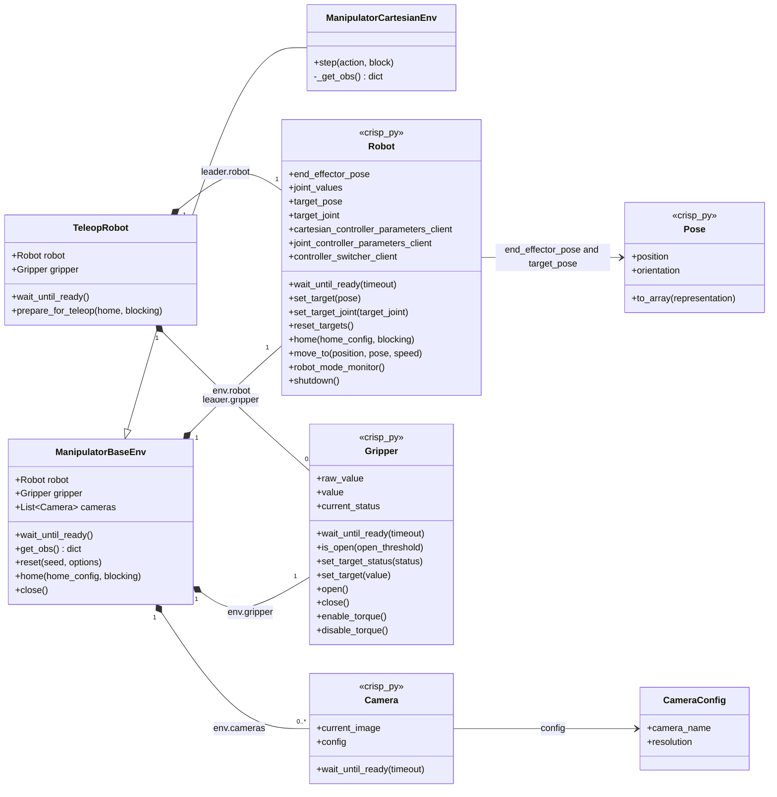
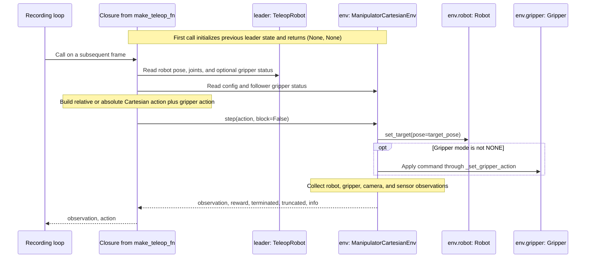
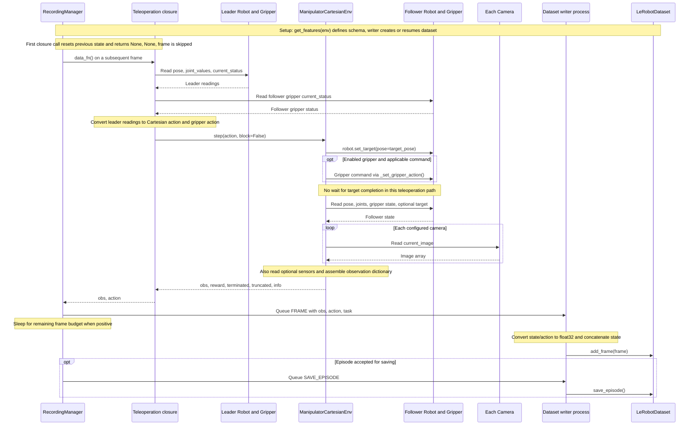

# Leader–follower teleoperation: classes, hardware API, and recording

The leader is a `TeleopRobot`; the Cartesian follower is a
`ManipulatorCartesianEnv`. Both **contain** `crisp_py` hardware interface objects;
neither inherits from `Robot` or `Gripper`.

**Scope:** the hardware members below are verified from this project's call
sites, not from an installed `crisp_py` implementation. They are the relevant
API subset, not an exhaustive library reference. Signatures are abbreviated;
internal ROS subscriptions, buffering, units of raw gripper values, and
timestamp semantics are not inferred here.

## 1. Class relationships and hardware API

Members **without parentheses** are accessed as attributes/properties. Members
**with parentheses** are methods. `+` denotes public access.

### Signal flow: recording loop → teleoperation → follower

### Responsibilities and accessible operations

| Interface | Read data | Send commands / manage operation |
|---|---|---|
| `Robot` | `end_effector_pose`, `joint_values`; `target_pose` and `target_joint` describe targets, not measured state | `set_target()`, `set_target_joint()`, `home()`, `move_to()`, `reset_targets()`, `wait_until_ready()`, `shutdown()` |
| `Gripper` | `current_status`, `raw_value`, `value`, `is_open()` | `set_target_status()`, `set_target()`, `open()`, `close()`, torque enable/disable, readiness wait |
| `Camera` | `current_image`; `config.camera_name` identifies the image stream | `wait_until_ready()`; this recording path uses no explicit capture/start-recording method |
| `Pose` | `position`, `orientation`; `to_array(representation=...)` converts a pose to a numeric vector | Used to construct targets and compute leader pose differences |

Controller configuration is accessed through nested robot clients, for example
`robot.cartesian_controller_parameters_client.load_param_config(...)` and
`robot.controller_switcher_client.switch_controller(...)`. These configure
control; they are not observation-reading methods.

**Reading data does not require sending a new command.** Use `env.get_obs()` to
collect the configured follower observations without calling `env.step()`.
Conversely, `step()` commands the follower and then collects observations.

## 2. Which readings become recorded data?

**Recorded frame = follower observations + leader-derived action + task label.**
Leader readings generate commands; they are not saved as separate observations.

`make_teleop_fn(env, leader)` connects both objects through a closure, not another
class or a direct reference between them.

### Leader readings → recorded action

To tell the follower what to do, the closure:

- Reads `leader.robot.end_effector_pose` to form a Cartesian action: the
    difference from the previous pose for relative actions, or the current pose
    for absolute actions.
- Reads `leader.robot.joint_values`; these contribute to the arm action only
    in joint-control mode.
- Reads `leader.gripper.current_status` to form the gripper command, using
    `False` when no leader gripper is present. It also reads
    `env.gripper.current_status` for the gripper-action conversion, particularly
    in relative modes.
- Combines the arm and gripper commands into `action` and calls
    `env.step(action, block=False)`. It returns the follower's observations and
    this action to the recording loop.

The Cartesian action has 7 elements for Euler/angle-axis orientation, or 8 for
quaternion orientation at the environment level. Saving this `action` preserves
the command derived from the leader, **not a separate recording of the leader's
measured state**. It is also not a measurement of the follower's resulting motion.

### Follower readings → recorded observations

| Source / access | Dataset key | Shape / meaning |
|---|---|---|
| Leader readings → `make_teleop_fn(env, leader)` → `env.step(action)` | `action` | Leader-derived command, **not follower motion feedback**; saved as `float32` before environment target clipping. Relative gripper commands also use follower gripper status. |
| `env.robot.end_effector_pose.to_array(representation=env.config.orientation_representation)` | `observation.state.cartesian` | `(6,)` for Euler/angle-axis or `(7,)` for quaternion; pose feedback, with the environment's representation handling applied |
| `env.robot.joint_values` | `observation.state.joints` | `(N,)`, where `N` is the robot's joint count |
| `env.gripper.raw_value` | `observation.state.gripper` | `(1,)`, used for `ABSOLUTE_CONTINUOUS` mode |
| `env.gripper.current_status` | `observation.state.gripper` | `(1,)`, converted to float in other enabled gripper modes |
| `env.robot.target_pose.to_array(representation=env.config.orientation_representation)` | `observation.state.target` | Optional Cartesian target pose; not the measured pose |
| `camera.current_image`, for each `camera` in `env.cameras` | `observation.images.<camera_name>` | Declared as `(*camera.config.resolution, 3)`, `uint8` |
| `sensor.value`, for each `sensor` in `env.sensors` | `observation.state.sensors_<sensor_name>` | Optional extra sensor data, shaped by sensor config |

Cartesian, joint, gripper, and target state fields are selected through
`env.config.observations_to_include_to_state`. Configured cameras and sensors
are included by `_get_obs()` independently of that state selection. With
`gripper_mode=NONE`, a selected gripper observation is a zero placeholder.

The recorder also writes:

- `task`: the episode task passed to `record_episode()`. The writer uses this
    label, rather than relying on `env.task`.
- `observation.state`: the concatenation of individual follower state observations.
- Individual observation fields present in the generated dataset feature schema.

## 3. One recording frame: UML sequence

### Detailed view: hardware reads and dataset writing

The following expands the signal-flow diagram in Section 1 with camera reads,
frame pacing, and the separate dataset writer process.

The hardware interfaces provide values and accept commands; **the recording
manager and dataset writer perform persistence**, not `Robot`, `Gripper`, or
`Camera` themselves. `get_features(env)` declares camera fields as video by
default, while each collected observation supplies an image array.

## 4. Important recording details in the current implementation

1. **Command/read ordering is not synchronization.** Observations are collected
     after `set_target()`, but `block=False` does not wait for motion completion.
     This code also does not align camera and robot readings by timestamps or
     guarantee a new camera frame on every iteration.
2. **Recorded action differs from measured motion.** The stored action is the
     closure's input to `step()`, not the measured displacement. The follower may
     clip its target position to the safety box, so the recorded action is not
     necessarily the final clipped target command either.
3. **Gripper labels are mode-dependent.** The teleoperation action uses
     `current_status`, even in `ABSOLUTE_CONTINUOUS` mode. That mode records
     `raw_value` as the observation, but the current `_set_gripper_action()` uses
     the same 0.5-threshold status commands as `ABSOLUTE_BINARY`. Do not assume a
     continuous leader position command or infer raw-value units from the name.
4. **FPS is a requested loop rate.** This script defaults `--fps` to 15 and the
     manager sleeps for the remaining frame budget. Slow processing can reduce
     the achieved rate; sensor updates are not guaranteed to match it. Video
     feature metadata separately uses `env.config.control_frequency`, so check
     that it agrees with the intended recording rate.
5. **The feature helper currently assumes six Cartesian pose components.**
     Although the environment supports quaternion observations/actions,
     `get_features()` hard-codes Cartesian names and a seven-element action
     schema. Quaternion recording needs schema changes before use.
6. **Combined-state ordering deserves attention.** `concatenate_state_features()`
     follows observation dictionary order, while feature names are generated by
     iterating the observation space. Do not assume these orders match when
     interpreting the combined vector. In the current observation construction,
     enabled fields appear as Cartesian, gripper, joints, sensors, then target.

## Source references

- Leader and factory: [crisp_gym/teleop/teleop_robot.py](../crisp_gym/teleop/teleop_robot.py)
- Base environment, Cartesian follower, and factory: [crisp_gym/envs/manipulator_env.py](../crisp_gym/envs/manipulator_env.py)
- Leader configuration: [crisp_gym/teleop/teleop_robot_config.py](../crisp_gym/teleop/teleop_robot_config.py)
- Follower configuration: [crisp_gym/envs/manipulator_env_config.py](../crisp_gym/envs/manipulator_env_config.py)
- Teleoperation closure: [crisp_gym/record/record_functions.py](../crisp_gym/record/record_functions.py)
- Recording manager and writer: [crisp_gym/record/recording_manager.py](../crisp_gym/record/recording_manager.py)
- Dataset feature schema: [crisp_gym/util/lerobot_features.py](../crisp_gym/util/lerobot_features.py)
- Recording orchestration: [crisp_gym/scripts/record_lerobot_format_leader_follower.py](../crisp_gym/scripts/record_lerobot_format_leader_follower.py)

Open this document in a Mermaid-capable Markdown preview to render the diagrams.